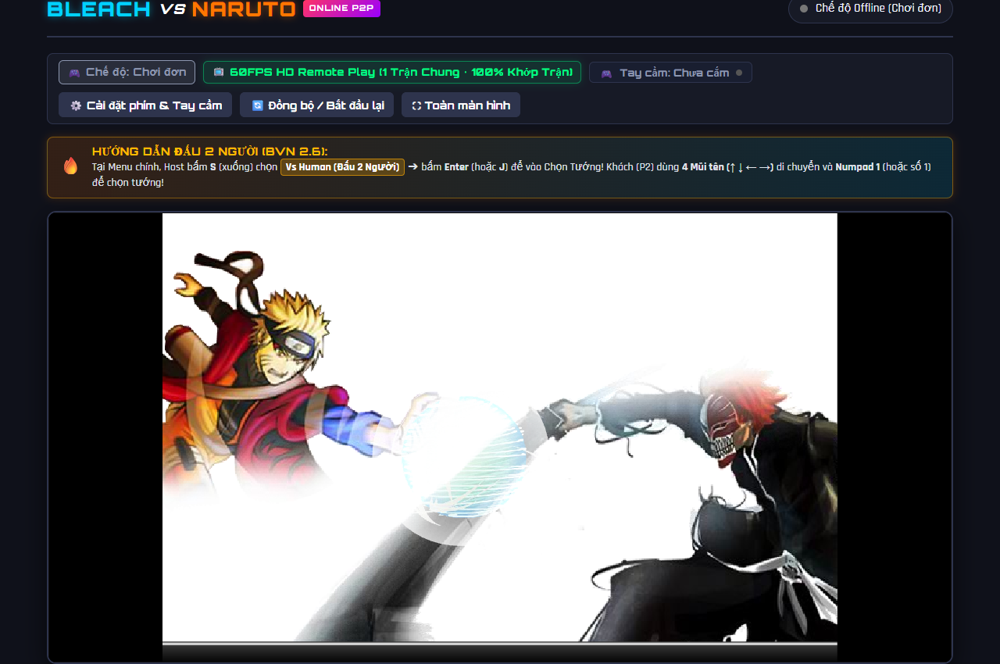
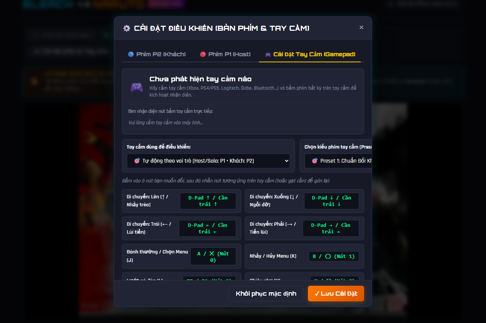
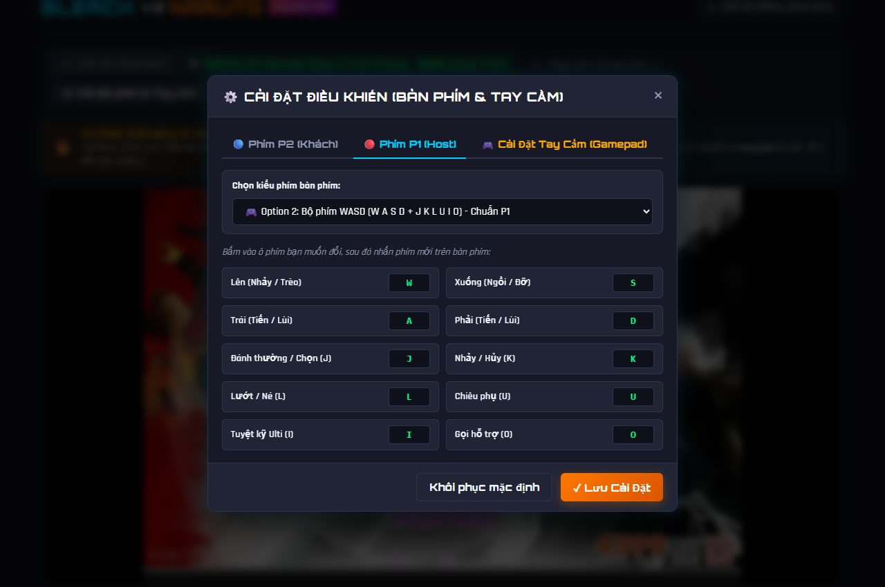
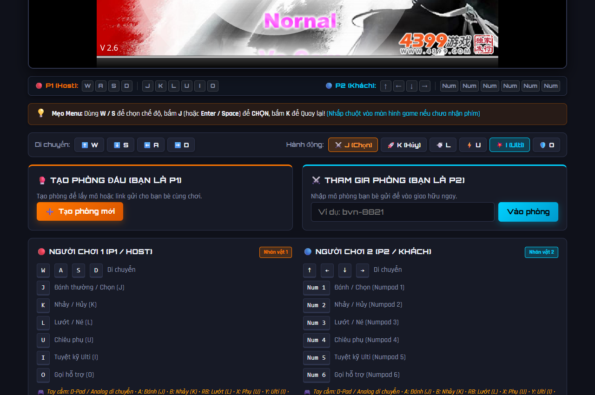
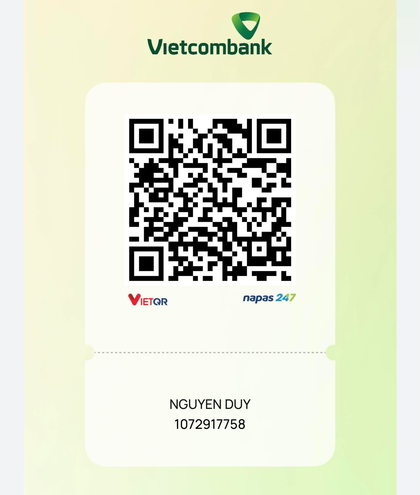

# ⚔️ Bleach vs Naruto 2.6 - Online P2P (60FPS HD Remote Play)

[](#)
[](#)
[](#)
[](#)
[](#)

Dự án đưa tựa game đối kháng huyền thoại tuổi thơ **Bleach vs Naruto 2.6** lên trình duyệt web hiện đại, cho phép 2 người chơi so tài qua mạng Internet thông qua **WebRTC Peer-to-Peer** với công nghệ **60FPS HD Remote Play** (1 trận chung, 100% khớp trận, không lệch frame) cùng hỗ trợ đầy đủ **Bàn phím** và **Tay cầm (Gamepad / Controller)**.

---

## 📸 Hình ảnh giao diện (Screenshots)

### 1. Màn hình trận đấu chính (Main Interface)
Giao diện sắc nét 1080p chạy trên nền WebAssembly Ruffle Flash với toolbar điều khiển, đèn báo trạng thái vai trò và hệ thống Input HUD trực quan.



---

### 2. Cài đặt Tay Cầm Gamepad (Gamepad Settings & Live Tester)
Hỗ trợ mọi loại tay cầm (Xbox, PlayStation, Logitech, Dobe, Bluetooth...). Tích hợp Live Button Tester, kiểm tra độ rung Haptics, 3 bộ Preset chuẩn và tùy ý đổi nút theo sở thích.



---

### 3. Cài đặt Bàn Phím Đa Dạng (Keyboard Presets)
Hỗ trợ 4 kiểu điều khiển bàn phím linh hoạt: Chuẩn Flash (4 Mũi tên & Numpad), Chuẩn P1 (WASD), Bộ phím Laptop (IJKL + ZXCVBN không cần Numpad), và Tự do map phím cá nhân.



---

### 4. Phòng Đấu Online (Lobby) & Hướng Dẫn Điều Khiển
Tạo phòng lấy mã / link mời 1 chạm, thanh phím ảo (Virtual Controls) hỗ trợ bấm chuột, đèn báo Real-time Input HUD và bảng phím chi tiết.



---

## 🚀 Tính năng nổi bật

### 🎮 1. Hỗ trợ Tay Cầm Chơi Game (Gamepad API)
- **Tương thích toàn diện:** Xbox (360, One, Series X|S), PlayStation (DualShock 4, DualSense PS5), Logitech, Nintendo Switch Pro Controller, tay cầm USB/Bluetooth giá rẻ.
- **Di chuyển thông minh:** Tự động hỗ trợ cả **D-Pad** lẫn **Cần gạt Analog Trái (Thumbstick)** với cơ chế Deadzone `0.45` chống trôi cần.
- **Nút Start vào trận:** Bấm `Start` trên tay cầm tự động gửi lệnh `Enter` và `J (Chọn)` để điều hướng menu và vào trận mà không cần chạm bàn phím.
- **Đèn nhận diện nút bấm trực tiếp (Live Button Tester):** Kiểm tra tín hiệu các nút bấm ngay trong bảng cài đặt theo thời gian thực.
- **Phản hồi rung (Haptics Rumble):** Nút kiểm tra rung mô-tơ tay cầm chân thực.
- **Chơi 2 người trên 1 máy tính:** Tự động gán hoặc chọn riêng biệt (Tay #1 = P1, Tay #2 = P2) để 2 bạn bè cắm 2 tay cầm đấu đối kháng cùng nhau.

### 📺 2. 60FPS HD Remote Play (1 Trận Chung • 100% Khớp Trận)
- **100% Khớp trận:** Khắc phục triệt để vấn đề "lệch trận / desync" của các bản game Flash cũ. Máy Host chạy game gốc và stream hình ảnh sắc nét 60FPS HD kèm âm thanh qua WebRTC Canvas Capture cho máy Khách.
- **Khóa cứng 60 FPS (Ultra Smooth `maintain-framerate`):** Bộ mã hóa WebRTC ưu tiên giữ vững 60 FPS tuyệt đối cho game đối kháng, không drop khung hình ngay cả khi mạng biến động.
- **Tùy chọn chất lượng truyền tải (Stream Quality Selector):**
  - ⚡ **Siêu mượt 60FPS (Khuyên dùng):** Bitrate tối ưu 3.5 Mbps, nén chuyển động siêu tốc (`contentHint: motion`), chạy mượt trên cả Wifi và mạng 4G.
  - 💎 **Cân bằng HD 60FPS:** Bitrate 5.5 Mbps, hình ảnh sắc nét chuẩn HD.
  - 👑 **Siêu nét 1080p:** Bitrate 9.0 Mbps dành cho mạng LAN / cáp quang tốc độ cao.
- **Tăng tốc phần cứng GPU (Hardware Screen Share):** Nút **"📺 Bật Tab 60FPS GPU"** cho phép máy Host chia sẻ trực tiếp Tab bằng bộ giải mã GPU phần cứng (NVENC/QuickSync/AMF) giảm tải 50% CPU cho máy Host.
- **Tiết kiệm tài nguyên máy Khách (Zero CPU Overhead):** Tự động đình chỉ hoàn toàn (`suspend`) engine Flash local trên máy Khách khi vào trận, dành 100% phần cứng máy Khách cho phát video mượt mà.
- **Điều khiển siêu tốc:** Máy Khách gửi tín hiệu phím P2 trực tiếp qua WebRTC DataChannel P2P (độ trễ dưới 15ms).

### ⌨️ 3. 4 Kiểu Điều Khiển Bàn Phím (Keyboard Presets)
- **Option 1 (Chuẩn Flash):** 4 Mũi tên (`↑` `↓` `←` `→`) + Numpad `1..6` (hỗ trợ cả hàng phím số `1..6`).
- **Option 2 (Chuẩn P1):** `W` `A` `S` `D` di chuyển + `J` `K` `L` `U` `I` `O` ra đòn.
- **Option 3 (Dành riêng cho Laptop):** `I` `J` `K` `L` di chuyển + `Z` `X` `C` `V` `B` `N` ra đòn (không lo bàn phím laptop thiếu phím Numpad).
- **Option 4 (Tự map phím Custom):** Nhấp chọn ô phím và ấn phím mới bất kỳ trên bàn phím.

### 🔴 4. Đèn Báo Phím Thời Gian Thực (Input HUD) & Phím Ảo (Virtual Controls)
- Hiển thị trực tiếp các nút mà P1 và P2 đang bấm trên màn hình.
- Thanh phím ảo (Virtual Controls Bar) hỗ trợ thao tác bằng chuột hoặc màn hình cảm ứng.

### 🔄 5. Bỏ qua Giới thiệu & Đồng bộ Ván Mới (Sync Restart)
- Bỏ qua nhanh đoạn intro mở đầu chỉ bằng 1 nút bấm.
- Nút "Đồng bộ / Bắt đầu lại" giúp khởi động lại game từ Frame 0 trên cả 2 máy khi muốn bắt đầu ván đấu mới.

---

## 🕹 Bảng điều khiển mặc định

### Người chơi 1 (P1 / Host)
| Hành động | Bàn phím (WASD) | Tay cầm (Arcade Preset) |
| :--- | :--- | :--- |
| **Di chuyển** | `W` `A` `S` `D` | D-Pad hoặc Cần gạt Analog Trái |
| **Đánh thường / Chọn Menu** | `J` | Nút `A` (Xbox) / `✕` (PlayStation) |
| **Nhảy / Hủy Menu** | `K` | Nút `B` (Xbox) / `◯` (PlayStation) |
| **Lướt / Né đòn** | `L` | Nút `RB` / `R1` |
| **Chiêu phụ** | `U` | Nút `X` / `▢` |
| **Tuyệt kỹ (Ulti)** | `I` | Nút `Y` / `△` |
| **Gọi trợ thủ** | `O` | Nút `LB` / `L1` |
| **Bắt đầu / Menu** | `Enter` / `Space` | Nút `Start` / `Options` |

### Người chơi 2 (P2 / Khách)
| Hành động | Bàn phím (Option 1) | Bàn phím (Laptop) | Tay cầm (Gamepad) |
| :--- | :--- | :--- | :--- |
| **Di chuyển** | `↑` `↓` `←` `→` | `I` `J` `K` `L` | D-Pad / Cần Analog |
| **Đánh thường / Chọn** | `Numpad 1` (hoặc số `1`) | `Z` | Nút `A` / `✕` |
| **Nhảy / Hủy** | `Numpad 2` (hoặc số `2`) | `X` | Nút `B` / `◯` |
| **Lướt / Né** | `Numpad 3` (hoặc số `3`) | `C` | Nút `RB` / `R1` |
| **Chiêu phụ** | `Numpad 4` (hoặc số `4`) | `V` | Nút `X` / `▢` |
| **Tuyệt kỹ (Ulti)** | `Numpad 5` (hoặc số `5`) | `B` | Nút `Y` / `△` |
| **Gọi trợ thủ** | `Numpad 6` (hoặc số `6`) | `N` | Nút `LB` / `L1` |

---

## 🔥 Hướng dẫn chọn chế độ đấu 2 người trong game (BVN 2.6)

1. Tại màn hình Menu chính của game, Host bấm phím **S** (xuống) hoặc gạt cần gạt tay cầm xuống để chọn mục **Vs Human (Đấu 2 Người)**.
2. Bấm phím **Enter** (hoặc **J** / nút **A** trên tay cầm) để vào màn hình Chọn Tướng.
3. **P1 (Host):** Dùng `W A S D` và phím `J` (hoặc nút `A` tay cầm) để chọn nhân vật.
4. **P2 (Khách):** Dùng `4 Mũi tên` và phím `Numpad 1` / `Số 1` (hoặc nút `A` tay cầm) để chọn nhân vật.

---

## 🛠 Hướng dẫn chạy trên máy (Local Development)

### Yêu cầu:
- [Node.js](https://nodejs.org/) (phiên bản 18 trở lên).

### Các bước cài đặt:
```bash
# 1. Clone repository về máy
git clone https://github.com/DuyOrbit/naruto-vs-bleach-online.git
cd naruto-vs-bleach-online

# 2. Cài đặt các thư viện cần thiết
npm install

# 3. Chạy server phát triển
npm start
```

Mở trình duyệt truy cập: **`http://localhost:3000`** (hoặc qua WAMP/XAMPP tại `http://localhost/naruto-vs-bleach-online`).

---

## 🌐 Hướng dẫn chơi Online cùng bạn bè (Deploy)

### Cách 1: Sử dụng Render.com (Miễn phí 100%)
1. Đăng nhập vào [Render.com](https://render.com/).
2. Nhấn **New +** $\rightarrow$ Chọn **Web Service**.
3. Kết nối với Repository GitHub `DuyOrbit/naruto-vs-bleach-online`.
4. Điền cấu hình:
   - **Environment:** `Node`
   - **Build Command:** `npm install`
   - **Start Command:** `node server.js`
5. Nhấn **Create Web Service**. Sau khi hoàn tất, Render sẽ cấp cho bạn đường link (ví dụ: `https://naruto-vs-bleach-online.onrender.com`).
6. Bạn vào web, nhấn **"Tạo phòng mới"** $\rightarrow$ bấm **"🔗 Copy Link Mời Bạn Bè"** và gửi cho bạn bè để chiến cùng nhau ngay lập tức!

---

## ☕ Ủng hộ tác giả (Donate)

Dự án **Bleach vs Naruto Online P2P** được xây dựng và duy trì hoàn toàn miễn phí, không chèn quảng cáo nhằm mang lại trải nghiệm tuổi thơ tuyệt vời nhất cho cộng đồng game thủ.

Nếu bạn yêu thích dự án và muốn mời tác giả một ly cà phê để tiếp thêm năng lượng duy trì server & phát triển thêm nhiều tính năng mới, bạn có thể ủng hộ qua mã QR hoặc thông tin ngân hàng bên dưới:

<div align="center">
  
  <br/>

| Thông tin ngân hàng | Chi tiết |
| :--- | :--- |
| **Ngân hàng** | **Vietcombank (VCB)** |
| **Chủ tài khoản** | **NGUYEN DUY** |
| **Số tài khoản** | `1072917758` |
| **Nội dung CK gợi ý** | `BVN Donate` |

  <p><em>Chân thành cảm ơn mọi sự đóng góp và ủng hộ quý báu từ bạn! ❤️</em></p>
</div>

---

## 📜 Giấy phép & Bản quyền
Dự án được xây dựng cho mục đích học tập và giải trí phi thương mại. Mọi tài sản hình ảnh, âm thanh và mã nguồn gốc Flash của trò chơi *Bleach vs Naruto 2.6* thuộc về nhà phát triển gốc Jianhun (剑魂).

